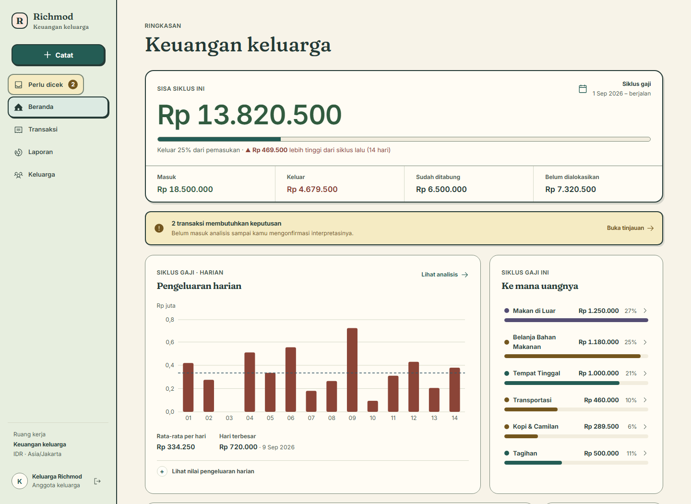
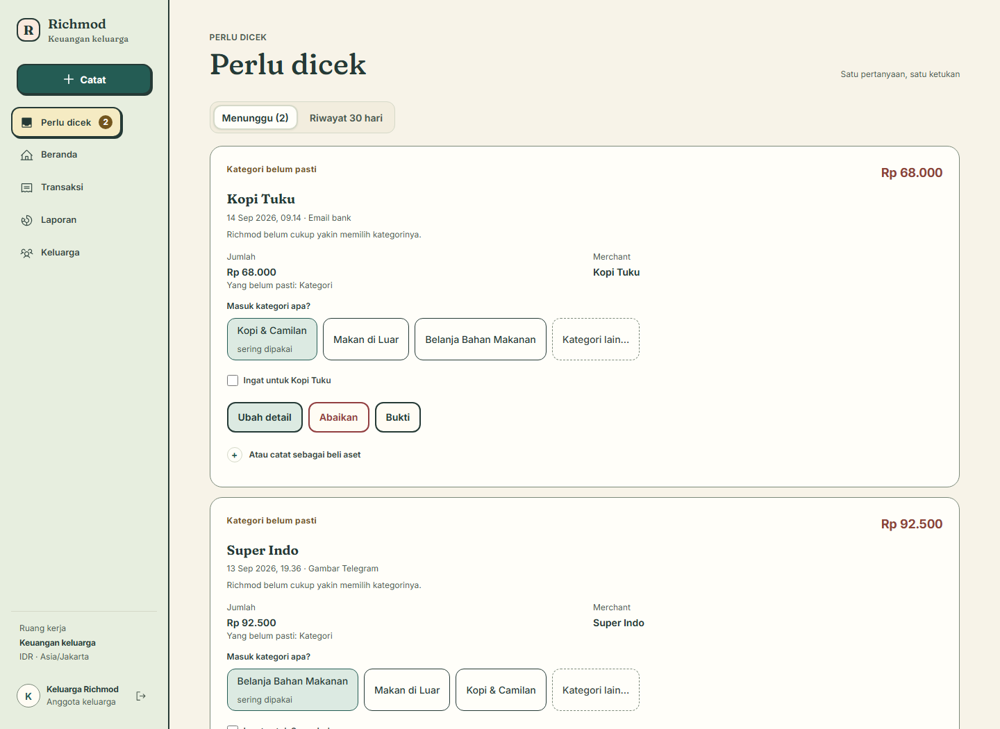
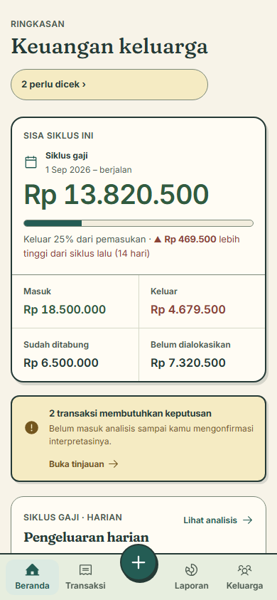
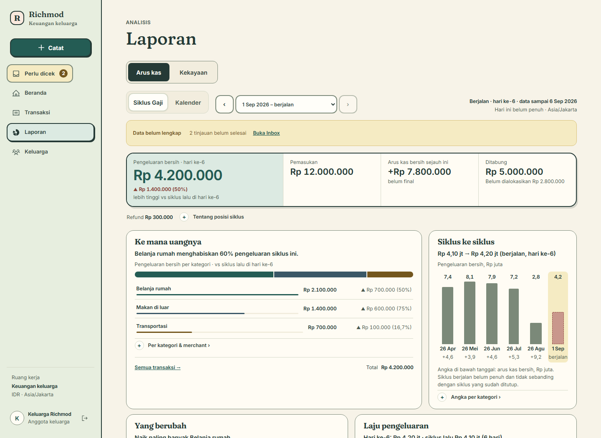
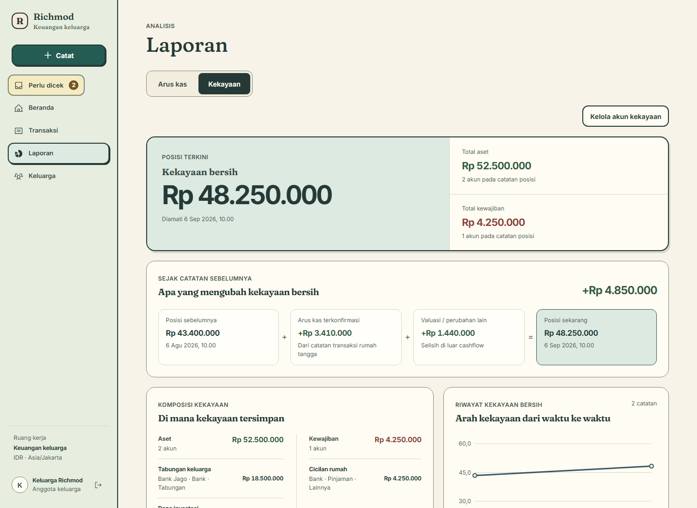
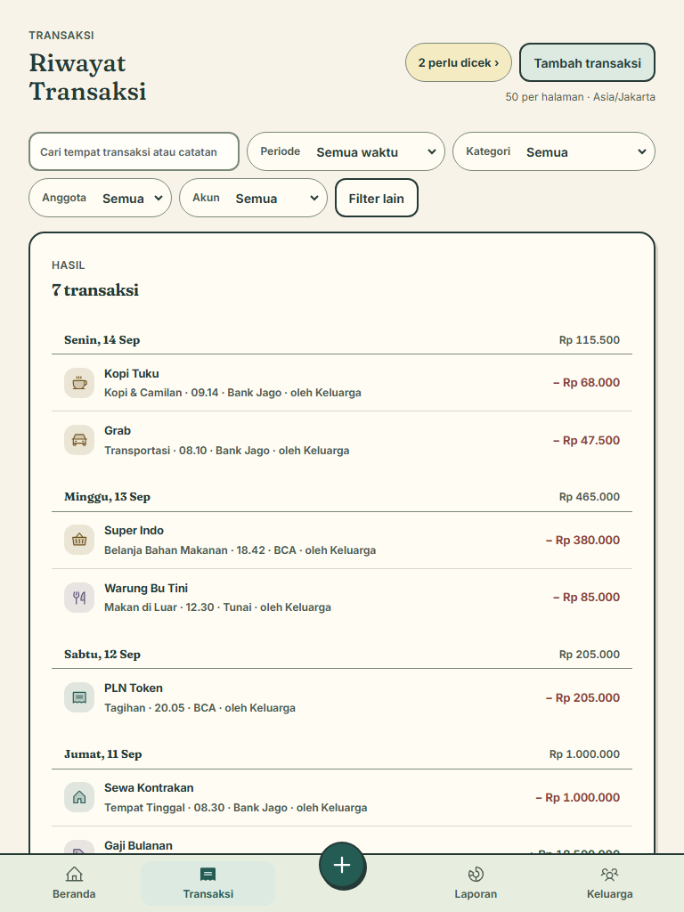
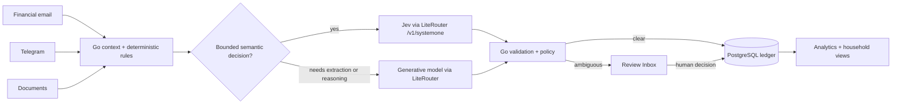

<div align="center">


# Richmod

Self-hosted household finance: email, Telegram and documents go into one ledger, and anything uncertain goes to a human.

[](https://github.com/raufimusaddiq/richmod/actions/workflows/ci.yml)


</div>

| Beranda | Perlu dicek | Phone |
| --- | --- | --- |
|  |  |  |

| Laporan · Arus kas | Laporan · Kekayaan | Transaksi (tablet) |
| --- | --- | --- |
|  |  |  |

The screenshots use synthetic data. To regenerate them, see the [README showcase runbook](docs/runbooks/readme-showcase.md).

## How it works



Go owns exact facts, arithmetic, authorization, target binding, reconciliation and all financial state. Jev handles bounded semantic judgments where the answer comes from a known set. Generative models are used only for open-ended extraction, vision, reasoning and prose. No model reads or writes the database.

Email arrives through Cloudflare Email Routing; see the [Cloudflare email ingress runbook](docs/runbooks/cloudflare-email-ingress.md).

## What it does

- Takes forwarded bank and provider notification emails through a household-scoped address, without bank credentials.
- Records transactions, answers questions and resolves reviews over Telegram.
- Reads receipts, payslips, invoices, screenshots and transfer proofs through one document pipeline.
- Sends ambiguous facts to **Perlu dicek** instead of guessing. Each card asks one question with history-ranked one-tap answers, an inline **Urungkan** to reopen a decision, and opt-in merchant learning ("Ingat untuk ...").
- Gives four permanent places (**Beranda**, **Transaksi**, **Laporan** with *Arus kas* and *Kekayaan* tabs, and **Keluarga**), plus **Perlu dicek** when something waits and a global **+ Catat** sheet for fast entry and multi-image upload.
- Shows a day-grouped ledger with inline merchant alias rename and an audited source timeline.
- Computes salary-cycle analytics, takeaway sentences and a direction-safe category palette in Go, and records Wealth snapshots of assets, liabilities and net worth over time.
- Keeps source evidence attached to each decision so the ledger stays auditable.

## Safety rules

- PostgreSQL is the canonical state, and Go owns every financial mutation.
- Money is stored as PostgreSQL `NUMERIC`, never floating point.
- Every mutation is household-scoped and audited.
- Deduplication links evidence and never deletes it.
- Model output is untrusted and passes deterministic validation first.
- Ambiguity goes to review, not to a guess.
- Webhooks and jobs are idempotent.
- Deterministic features keep working when the AI gateway is down.
- Merchant learning is opt-in: one correction does not create a permanent rule.
- Richmod authenticates only to LiteRouter and never stores upstream provider credentials.

## Run it

```bash
cp .env.example .env    # replace every placeholder
docker compose up --build
```

Health checks are `http://localhost:8080/healthz` and `http://localhost:8080/readyz`. The same `api` service serves the web app at `http://localhost:8080`.

Create the first owner once. The password goes in on standard input so it stays out of shell history:

```bash
printf '%s\n' 'use-a-unique-12-plus-character-password' \
  | docker compose exec -T api /bootstrap \
      --email owner@example.com \
      --name 'Owner Name' \
      --household 'My Household'
```

Further households are added by a Super Admin or with `/bootstrap --new-household`; see "Adding another household" in the [production deployment runbook](docs/runbooks/production-deployment.md).

## Develop

```bash
node scripts/check-comments.mjs
cd apps/web && npm ci && npm test && npm run build
cd apps/api && go test ./... && go vet ./...
cd apps/worker && go test ./... && go vet ./...
```

Database-backed tests need an isolated PostgreSQL; the [disposable test matrix](docs/runbooks/disposable-test-matrix.md) has the commands. To ship a change, read [CONTRIBUTING.md](CONTRIBUTING.md) and the [sprint delivery runbook](docs/runbooks/sprint-delivery.md).

## Scope

V1 covers household income and expense tracking plus additive Wealth observations, savings intent classification and salary-cycle residual reconciliation. Transactions are the cashflow ledger, Wealth snapshots are point-in-time observations, and residuals are review metadata rather than transactions.

Wealth is manual and snapshot-level. It does not do live price feeds, broker or wallet sync, per-security positions, cost basis, P&L, TWR, XIRR, investment advice, historical savings inference or automatic residual-to-transaction conversion.

The latest release is [v0.beta](https://github.com/raufimusaddiq/richmod/releases/tag/v0.beta).

## Docs

Start with the [documentation index](docs/README.md). Also see [AGENTS.md](AGENTS.md), [CONTRIBUTING.md](CONTRIBUTING.md) and [SECURITY.md](SECURITY.md).
